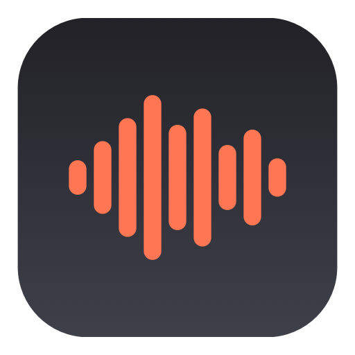

<p align="center">
  
</p>

<h1 align="center">Hushtype</h1>

<p align="center">
  <strong>Hold a key, talk, let go. Your words land wherever your cursor is.</strong><br>
  A free, open-source, native macOS dictation app. Whisper runs on your Mac. Nothing leaves it.
</p>

<p align="center">
  <a href="https://github.com/sturzael/hushtype/releases/latest"></a>
  <a href="https://github.com/sturzael/hushtype/actions"></a>
  <a href="LICENSE"></a>
  
  <a href="https://github.com/sturzael/hushtype/stargazers"></a>
</p>

<p align="center">
  
</p>

Hushtype is a push-to-talk voice typing tool for Mac, built as a free replacement for **Willow Voice**, **Wispr Flow**, **Superwhisper** and **MacWhisper**-style dictation. It is a single native Swift binary, a couple of megabytes, no Electron, no account, no subscription.

## Why Hushtype

- **100 % on-device.** Speech-to-text runs with [WhisperKit](https://github.com/argmaxinc/WhisperKit) on the Apple Neural Engine. Works offline. Your audio never touches a server.
- **Any hotkey chord, left and right aware.** Hold *left ⌃ + left ⌥* (default), *right ⌥* alone, *fn*, or add an F-key. Hold-to-talk or press-to-toggle.
- **Pastes anywhere.** Slack, Gmail, Xcode, Terminal, Notes, your browser: wherever the cursor is.
- **Willow-style pill.** Live waveform while you speak, spinner while it thinks, tick when it lands. Esc cancels.
- **Optional AI polish.** Add a Claude API key and Hushtype strips "um"s, fixes punctuation and spells the names in your personal dictionary correctly. Off by default; falls back to the raw transcript if the network is down.
- **Native and tiny.** Swift + SwiftUI + AppKit. Menu-bar only. Launch at login. History window with one-click copy.

## Install

**Download:** grab `Hushtype.app.zip` from the [latest release](https://github.com/sturzael/hushtype/releases/latest), unzip, drag to Applications.
The app is not notarized yet, so the first launch needs a right-click → **Open**, or:

```bash
xattr -dr com.apple.quarantine /Applications/Hushtype.app
```

**Homebrew:**

```bash
brew install --cask sturzael/tap/hushtype
```

**Build from source** (Xcode 16+ / Swift 5.10+, Apple Silicon):

```bash
git clone https://github.com/sturzael/hushtype.git
cd hushtype
./build.sh          # → ~/Applications/Hushtype.app
open ~/Applications/Hushtype.app
```

## First run

1. Click the waveform icon in the menu bar → **Settings → Permissions**.
2. Grant **Microphone** and **Accessibility** (Accessibility is what lets a menu-bar app see the hotkey and paste for you).
3. The speech model (~630 MB) downloads once in the background. Status shows **Ready** when it is loaded.
4. Click into any text field, hold **left ⌃ + left ⌥**, speak, release.

## Settings

| Tab | What you can change |
|---|---|
| **General** | Hotkey chord (any mix of left/right ⌃ ⌥ ⇧ ⌘, fn, plus an optional F-key), hold vs toggle, Whisper model (Large v3 Turbo, Large v3, Distil, Base), language, sounds, launch at login |
| **Cleanup** | Claude polish on/off, model id, API key (or set `ANTHROPIC_API_KEY`), personal dictionary, style notes |
| **Permissions** | Microphone and Accessibility status with one-click prompts |

## How it compares

| | Hushtype | Willow Voice | Wispr Flow | Superwhisper | Handy |
|---|---|---|---|---|---|
| Price | Free, MIT | US$12–15/mo | US$12–15/mo | US$8.49/mo or lifetime | Free, MIT |
| Audio stays on device | Yes | Cloud by default | Cloud | Yes | Yes |
| Native Swift (no Electron/Tauri) | Yes | — | — | Yes | No (Tauri) |
| Left/right-specific modifier chords | Yes | No | No | Partial | No |
| AI cleanup with personal dictionary | Optional (your key) | Yes | Yes | Yes | No |
| Open source | Yes | No | No | No | Yes |

Prices and features as of October 2026; corrections welcome via PR.

## Privacy

Audio is captured with AVAudioEngine, converted to 16 kHz mono, transcribed in-process and discarded. The only network call Hushtype can make is the optional Claude cleanup, and only with a key you provide. There is no telemetry, no analytics, no update check.

## Contributing

Issues and PRs are welcome. See [CONTRIBUTING.md](CONTRIBUTING.md) for the layout, how to run the headless checks (`--transcribe`, `--test-hotkey`, `--render-overlay`) and the roadmap.

## Credits

Built on [WhisperKit](https://github.com/argmaxinc/WhisperKit) by Argmax. Made in Wellington, New Zealand by [Wild Interactive](https://wildinteractive.co.nz).

## License

[MIT](LICENSE)
